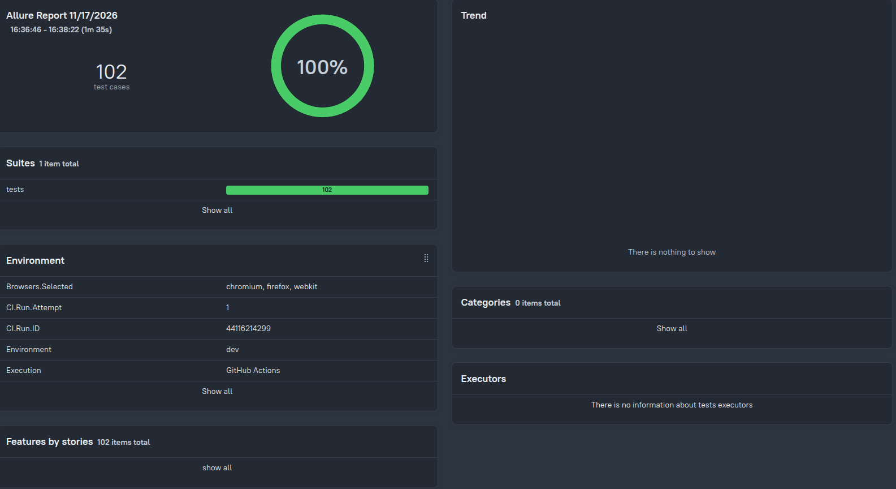
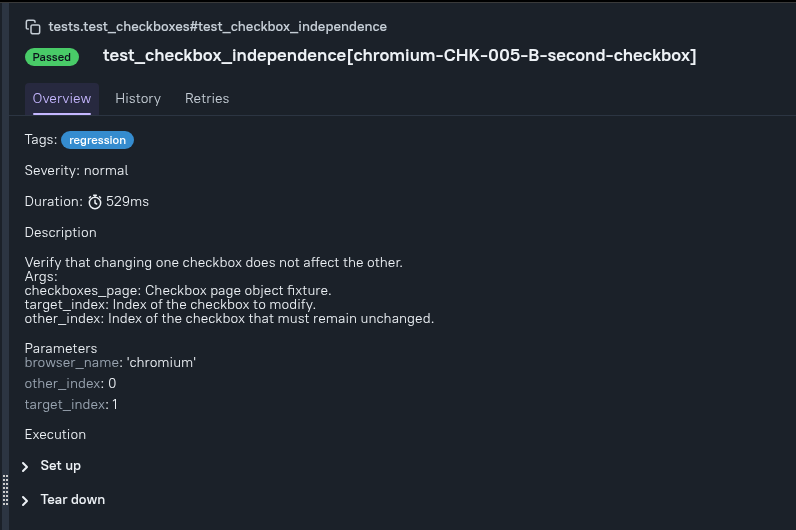

# Playwright Python QA Portfolio

A modular UI test automation portfolio built with **Python, pytest, and Playwright**. The project demonstrates maintainable automated testing practices, including Page Object Model (POM), data-driven scenarios, requirements traceability, cross-browser execution, containerization, and CI/CD reporting.

The application under test is [The Internet](https://the-internet.herokuapp.com/), a public web application with isolated examples of common UI behaviors.

## Features

- **Page Object Model:** UI interactions are separated from test assertions and scenarios.
- **Data-driven tests:** pytest parametrization provides descriptive scenario identifiers.
- **Reusable fixtures:** Browser, page-object, environment, and authentication setup are kept separate.
- **Environment configuration:** `dev`, `qa`, and `staging` are selected with `--env`; environment variables take precedence over the corresponding `.env` file.
- **Cross-browser coverage:** Chromium, Firefox, and WebKit.
- **Test reporting:** Allure and JUnit XML, with Playwright traces for investigation. Allure results include runtime environment, Python, OS, and browser metadata, plus automatic failure categories.
- **CI/CD:** GitHub Actions runs independent browser jobs and publishes test results.
- **Containerized execution:** Docker Compose provides an isolated local test environment; a Makefile supplies shorter development commands.

## Test Coverage

| Module | Test cases | Collected scenarios per browser | Description |
| --- | ---: | ---: | --- |
| Authentication | 8 | 8 | Valid and invalid login, logout, and protected-page access |
| Checkboxes | 8 | 9 | Visibility, state changes, independent behavior, and bulk selection |
| JavaScript Alerts | 7 | 9 | Alert, confirm, and prompt interactions and properties |
| File Upload | 8 | 8 | File types, filenames, empty files, missing files, and drag-and-drop |
| **Total** | **31** | **34** | **26 documented functional requirements** |

A full three-browser run collects **102 test instances** (34 per browser). Scenario collection and requirement mapping do not themselves establish successful functional execution; refer to current test reports for execution status.

## Project Structure

```text
.
├── config/                # Environment configuration and paths
├── data/                  # Test data and parameterized scenarios
├── docs/
│   ├── requirements/      # Functional requirements by module
│   ├── test-cases/        # Documented test cases by module
│   └── traceability.md    # Requirements-to-automation mapping
├── fixtures/              # Reusable pytest fixtures
├── pages/                 # Page Objects
├── resources/uploads/     # Sample upload files
├── tests/                 # Automated UI tests
├── utils/                 # Shared assertion helpers
├── .github/workflows/     # CI/CD workflows
├── Dockerfile
├── compose.yaml
├── .dockerignore
├── Makefile
├── conftest.py
├── pytest.ini
└── requirements.txt
```

## Prerequisites

Run the examples below from the repository root. Shell examples use Bash on Linux/macOS; Windows users can use WSL or adapt activation and environment-variable syntax to their shell.

For containerized execution:

- Docker Engine with Docker Compose **2.24.0 or later** (`env_file.required` is used).
- GNU Make, if using the shortcut commands.
- Network access to the configured application.

No local Python installation or Playwright browsers are needed for Docker execution. The image is based on `mcr.microsoft.com/playwright/python:v1.64.1-noble`, matching `playwright==1.64.1` in `requirements.txt`. The validated image uses Python 3.12; GitHub Actions uses Python 3.13.

For local execution without Docker, use Python 3.13 to match CI.

## Configuration

Create a local `.env.dev` file, using your target URL and test credentials:

```dotenv
BASE_URL=https://the-internet.herokuapp.com
TEST_USERNAME=your_test_username
TEST_PASSWORD=your_test_password
```

| Variable | Purpose | Required |
| --- | --- | --- |
| `BASE_URL` | Application base URL | For browser test execution |
| `TEST_USERNAME` | Valid test username | For tests that log in or use valid credential values |
| `TEST_PASSWORD` | Valid test password | For tests that log in or use valid credential values |

Checkboxes, JavaScript Alerts, File Upload, and the unauthenticated protected-page test do not require credentials. Authentication setup and login tests validate required credentials before navigation. Missing configuration produces a descriptive error.

**Without Docker:** `--env=dev`, `--env=qa`, or `--env=staging` selects `.env.<environment>` at the repository root. The default is `dev`. Process environment variables override file values; a generic `.env` file is not loaded by the Python configuration.

**With Docker Compose:** `TEST_ENV_FILE` selects the file injected into the container (default: `.env.dev`). The file is optional, so values can instead be supplied at runtime. No `.env` files are copied into the image. Pytest's `--env` does not change Compose's file selection: set both consistently when switching environments. Runtime `docker compose run -e NAME` options can forward exported shell variables and override file values.

Do not commit real credentials or local environment files. `.gitignore` excludes `.env` files except `.env.example`; `.dockerignore` excludes all `.env` files from the build context.

## Run Tests with Docker

The image runs as `pwuser` by default. Compose uses `LOCAL_UID` and `LOCAL_GID` (both default to `1000`) for the container process. Set them to your host IDs on Linux so generated artifacts have the expected ownership.

Prepare the bind-mount directories and build the image:

```bash
mkdir -p reports test-results
export LOCAL_UID="$(id -u)"
export LOCAL_GID="$(id -g)"
docker compose build
```

Run the entire suite in Chromium against the default `dev` environment:

```bash
docker compose run --rm playwright
```

The image's default command is `python -m pytest`. Override it to select a module or browsers:

```bash
# One module in Chromium
docker compose run --rm playwright \
  python -m pytest tests/test_login.py --env=dev --browser chromium

# All three browsers
docker compose run --rm playwright \
  python -m pytest --env=dev \
  --browser chromium --browser firefox --browser webkit

# Firefox with QA configuration
TEST_ENV_FILE=.env.qa docker compose run --rm playwright \
  python -m pytest --env=qa --browser firefox
```

To use credentials already exported in your shell, without placing their values in the command:

```bash
docker compose run --rm \
  -e BASE_URL -e TEST_USERNAME -e TEST_PASSWORD playwright
```

**Important:** Docker executes the test code included in the built image, not the latest files in your working directory. Only `reports/` and `test-results/` are bind-mounted; there is no source-mounted development mode. After modifying tests, Page Objects, fixtures, configuration code, resources, dependencies, or copied pytest configuration, run `make build` (or `docker compose build`) before executing the suite again. `make test` and `make test-all` do not rebuild an existing image. Changes to runtime environment variables or environment files require a new container, but no image rebuild.

### Makefile Shortcuts

The [Makefile](Makefile) wraps the same Compose service:

| Target | Behavior |
| --- | --- |
| `make prepare` | Create `reports/` and `test-results/`; also the default action of bare `make` |
| `make build` | Build the test image |
| `make test` | Prepare output directories and run the selected module/browser |
| `make test-all` | Prepare output directories and run Chromium, Firefox, and WebKit |

| Variable | Default | Purpose |
| --- | --- | --- |
| `ENV` | `dev` | Pytest environment |
| `BROWSER` | `chromium` | Browser for `make test`; `test-all` selects all three |
| `MODULE` | `tests/` | Test directory, module, or node ID |
| `PYTEST_ARGS` | Empty | Additional pytest arguments |
| `TEST_ENV_FILE` | `.env.$(ENV)` | Compose configuration file |
| `LOCAL_UID`, `LOCAL_GID` | Host `id -u`, `id -g` | Artifact ownership |

```bash
make build
make test
make test MODULE=tests/test_upload.py
make test BROWSER=firefox
make test ENV=qa
make test-all
make test PYTEST_ARGS="-n 2 -v"
```

An explicitly exported or supplied `TEST_ENV_FILE` overrides the Makefile default; ensure it matches `ENV`.

`-n 2` starts two **pytest-xdist worker processes**, not threads. Each worker may start its own browser. Without `-n`, tests run sequentially; selecting several browsers alone does not enable multiprocessing.

## Run Tests Without Docker

Create a virtual environment with Python 3.13 and install dependencies and browsers:

```bash
python3.13 -m venv .venv
source .venv/bin/activate
python -m pip install -r requirements.txt
python -m playwright install --with-deps
```

Browser system-dependency installation may require administrator privileges on Linux.

```bash
# Run the suite in parallel across all three browsers
# Without --browser, pytest-playwright defaults to Chromium.
# -n auto selects pytest-xdist workers; it does not select browser engines.
python -m pytest --env=dev -n auto \
  --browser chromium --browser firefox --browser webkit -v

# Run a single module in Chromium
python -m pytest tests/test_checkboxes.py --env=dev --browser chromium -v

# Collect all browsers without running tests, reports, or pytest cache
python -m pytest --collect-only -q -o addopts= -p no:cacheprovider \
  --browser chromium --browser firefox --browser webkit
```

Configure the selected environment before executing tests. Collection alone does not validate application access or credentials.

## Reports and Debugging

[pytest.ini](pytest.ini) enables the following outputs:

| Output | Host path with Compose | Behavior |
| --- | --- | --- |
| Allure raw results | `reports/allure-results/` | Written during test execution |
| JUnit XML | `reports/junit/results.xml` | Written at the end of the session |
| Playwright traces | `test-results/` | Retained for failed tests |
| Screenshots | `test-results/` | Captured for failed tests |

Compose persists both directories on the host. Pytest/Compose return a non-zero exit code when tests fail. Subsequent runs overwrite the default JUnit file, may accumulate Allure results, and clean the selected Playwright output directory. Preserve artifacts you need before another run, or select separate paths with `--junitxml`, `--alluredir`, and `--output`.

Allure raw results are not an HTML report. GitHub Actions generates the consolidated HTML report; the Dockerfile does not install Allure CLI or Java. Download the `allure-consolidated-report` artifact from a workflow run to obtain the generated report.

### Allure Report Preview

These static screenshots show historical results generated with Allure 2.46.1 from the project's `reports/allure-results/`: **102 passed, 0 failed**, with 34 executions each in Chromium, Firefox, and WebKit. They do not represent the current CI status.

#### Execution Overview



#### Test Execution Details

A representative checkbox test shows its passed status, duration, description, and Chromium-specific parameters.



## Continuous Integration

The [Playwright CI workflow](.github/workflows/playwright.yml) runs on pushes, pull requests targeting `main`, and manual dispatch.

- Browser jobs run on Ubuntu with Python **3.13**, using a Chromium/Firefox/WebKit matrix with `fail-fast: false`.
- Each job installs its browser and runs `python -m pytest --env=dev --browser <browser> -v -n 0`. Browser jobs can run concurrently; tests within each job run sequentially.
- Browser jobs are skipped for pull requests from forks. Configure repository secrets `TEST_BASE_URL`, `TEST_USERNAME`, and `TEST_PASSWORD`; `TEST_BASE_URL` is exposed to tests as `BASE_URL`.
- Each browser job uploads Allure raw results and JUnit XML as `playwright-results-<browser>`, retained for seven days. The workflow does **not** upload `test-results/`, so traces/screenshots are not included in those artifacts.
- The report job publishes JUnit results through `dorny/test-reporter` in GitHub Checks and the Actions summary, merges Allure results, and uploads `allure-consolidated-report`, also retained for seven days.

| Check | Failure behavior configured in the workflow |
| --- | --- |
| Browser tests | A failing pytest command fails its browser job |
| Pylint | The analysis step uses `continue-on-error: true` |
| pip-audit | The audit step uses `continue-on-error: true` |
| Gitleaks | The scan step is not marked `continue-on-error` |
| JUnit publication | `fail-on-error: false`; `fail-on-empty: true` |

These settings describe workflow execution, not repository branch-protection requirements. Docker and Makefile are local execution alternatives; GitHub Actions runs Python and Playwright directly.

## Requirements Traceability

See the [traceability matrix](docs/traceability.md), [functional requirements](docs/requirements/), and [test cases](docs/test-cases/) for detailed coverage. The suite contains **17 test functions**; parametrization produces the scenario counts listed above.

Requirement mapping coverage is distinct from verified execution coverage. A mapped requirement is not equivalent to a passing test or complete behavioral coverage.

## Design Principles

- Keep test intentions and assertions readable.
- Encapsulate UI interactions in Page Objects.
- Reuse fixtures instead of duplicating setup steps.
- Use stable scenario IDs for parameterized tests.
- Keep configuration and test data separate from test logic.
- Add abstractions only when they solve a demonstrated problem.

## Project Status

The four modules are implemented. Docker validation on **17 November 2026** recorded **102 passing tests** across Chromium, Firefox, and WebKit. Artifact persistence and a non-zero exit code for an intentional failure were also verified. This is historical validation, not a guarantee of subsequent runs; inspect current GitHub Actions results for current CI status.

This repository is a QA engineering portfolio and learning project, not a production service.
